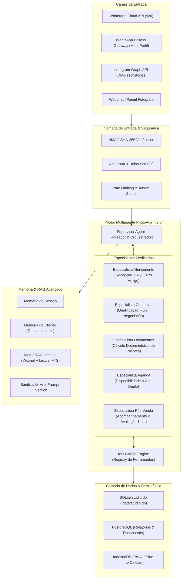

# DIAGNÓSTICO TÉCNICO & PLANO DE EVOLUÇÃO — PHOTOAGENT AI 2.0

## 1. Resumo Executivo da Auditoria (Estado Atual)

O projeto `whatsapp-studio-bot` é uma plataforma funcional de secretária virtual baseada em Flask, SQLite, Baileys e Meta Cloud API v20, configurada para atendimento fotográfico 24 horas.

### 1.1 Arquivos e Estrutura Identificada
- **Backend Central**: `app.py` (~167 KB, 4.070 linhas) contendo:
  - Rotas de Webhook WhatsApp (`/webhook` com validação HMAC `X-Hub-Signature-256`, anti-looping de IDs `processed_messages`, debounce de 3 segundos, filtro de eco e deduplicação).
  - Motor de IA: Gemini (`google.generativeai` / `google.genai`) com persona da secretária Bruna, pacotes do Gustavo Alves Fotografia e fallback determinístico.
  - Agendamento Atômico: Tabela `slots` com proteção `UNIQUE(studio_id, start_at)`, locks temporários de 5 minutos com job de liberação automática e transações `BEGIN IMMEDIATE`.
  - Modo Não Perturbe (`DND`): Atendimento silencioso 24 horas sem disparar notificações no celular do fotógrafo.
  - Multi-Perfil QR Code (`/conectar`): Gateway Node.js Baileys na porta 5006 gerenciando 4 sessões simultâneas e isoladas (`meu_numero`, `esposa`, `filho`, `bot_estudio`).
  - Geração de Comprovantes: Pillow gerando PNG com QR Code e #ID do slot.
  - Segurança & LGPD: Rota `/lgpd/delete`, `/lgpd/export`, `/privacidade` e consentimento explícito.
- **Providers**:
  - `providers/whatsapp_provider.py`: `CloudApiProvider` (Meta Cloud API oficial v20) e `BaileysProvider` (Gateway multi-perfil local).
  - `providers/instagram_provider.py`: Integração Instagram Graph API (comentários para DM, stories e feed).
- **Templates & Frontend**:
  - `templates/painel.html` e `templates/dashboard.html` (90 KB cada): Painel administrativo com abas de Agendamentos, Kanban de Ensaios, Conversas com tags de contatos, Pacotes Oficiais e Configuração.
  - `templates/comecar.html` (22 KB): Tela de onboarding e conexão 1-clique PWA (`manifest.json` com tema `#25D366`).
  - `templates/conectar.html` e `templates/conectar_perfil.html`: Central de conexão multi-perfil por QR Code e tela dedicada com auto-polling de 20s.
- **Banco de Dados Local (`studio.db`)**:
  - `studios`: 1 registro (Tenant #1: Gustavo Alves Fotografia, Bruna, modo DND, pacote R$ 7.500 / 8.800 / 11.350).
  - `slots`: 61 slots cadastrados.
  - `messages`: 370 mensagens históricas de conversas.
  - `processed_messages`: 5 IDs de controle anti-loop.
  - `contacts`: 10 contatos classificados (`cliente`, `amigo`, `familia`, `fornecedor`).
  - `ensaios`: 5 registros na esteira Kanban.
  - `waiting_queue`: 5 solicitações (humano e prévias pendentes).
  - `test_profiles`: 4 perfis de teste cadastrados com pastas isoladas.

---

## 2. Regras de Negócio Críticas e Ativos a Preservar (Invioláveis)

| Componente | Regra / Mecanismo | Garantia de Não-Regressão |
| :--- | :--- | :--- |
| **Anti-Looping** | `processed_messages` + debounce 3s + eco filter + followup_count max 2 | Jamais responder mensagens duplicadas ou do próprio bot |
| **Assinatura Webhook** | HMAC SHA-256 no header `X-Hub-Signature-256` com `APP_SECRET` | Rejeitar requisições forjadas com status 403 |
| **Anti-Duplo Agendamento** | `UNIQUE(studio_id, start_at) WHERE status='booked'` + `BEGIN IMMEDIATE` + Lock 5min | Jamais permitir 2 reservas no mesmo horário; conflito retorna 409 |
| **Commit em Operações** | `db.commit()` em deleções, reagendamentos e inserções | Persistência transacional em todas as operações |
| **Modo Silencioso DND** | Modos `NORMAL`, `DND` e `PAUSED` | Em `DND`, agendar 24h sem notificar o fotógrafo |
| **Persona Bruna (PDF)** | Essencial R$7.500, Premium R$8.800, Black R$11.350 + Extras | Preços reais do PDF do Gustavo Alves, cálculo determinístico |
| **Filtro Amigo/Família** | Tabela `contacts` com coluna `tipo` | Contatos amigos/família recebem resposta curta sem venda de pacote |
| **Comprovante Visual** | Geração com biblioteca Pillow | PNG com #ID, data, hora, cliente e QR Code em `/static/comprovantes/` |
| **Multi-Sessão QR** | Gateway Baileys na porta 5006 | 4 pastas de autenticação estritamente isoladas em `auth_session/` |
| **Compatibilidade PWA** | `manifest.json` (#25D366) e `service-worker.js` | Funcionalidade offline e instalação como aplicativo |

---

## 3. Arquitetura Alvo: PHOTOAGENT AI 2.0 (Multi-Tenant & Multi-Agente)

---

## 4. Plano de Fases para Execução Progressiva

- **Fase 1: Diagnóstico e Migração de Esquema**
  - Auditoria completa, criação do esquema de banco de dados expandido para multi-tenancy (`tenants`, `agent_configs`, `knowledge_documents`, `knowledge_chunks`, `quotes`, `automations`).
  - Migração de dados de `studio.db` sem perda de registros.

- **Fase 2: Motor Multiagente & Ferramentas Tipadas**
  - Implementação do `SupervisorAgent` e dos 5 especialistas com injeção de contexto.
  - Registro de ferramentas padronizadas com schema, validação e idempotência.

- **Fase 3: Memória do Cliente & Motor RAG Avançado**
  - Otimização de tokens via memória persistente (reconhecimento imediato do cliente).
  - Ingestão documental do PDF da proposta do Gustavo Alves com busca híbrida e isolamento por tenant.

- **Fase 4: CRM Fotográfico & Precificação Determinística**
  - Funil de vendas de 14 etapas integrado ao Kanban de 5 colunas.
  - Motor determinístico de cálculo de orçamentos (garantia de preço zero alucinação).

- **Fase 5: Agenda Atômica & Sincronização Offline**
  - Proteção de concorrência com transações imediatas e locks temporários.
  - Módulo de sincronização com IndexedDB para o PWA no celular.

- **Fase 6: Automações e Background Workers**
  - Follow-up de 30 horas com conformidade para a janela de 24h da Meta.
  - Lembretes automáticos (24h e 2h antes) e solicitação de avaliação pós-evento.

- **Fase 7: Painel Administrativo PhotoAgent 2.0**
  - Atualização visual e funcional: Kanban interativo, Construtor de Agentes sem código, Gestão da Base de Conhecimento RAG, Central de Prévias do Instagram.

- **Fase 8: Segurança, RLS e Bateria dos 12 Cenários de Teste**
  - Verificação de isolamento rigoroso entre múltiplos fotógrafos.
  - Execução da suíte completa com os 12 cenários de aceitação.
